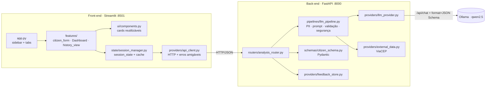

# 🏙️ CitizenTech — Portal Inteligente de Atendimento e Orientação ao Cidadão

> Global Solution 2026/2 · FIAP · Front-End em Sistemas de IA
> **Integrante:** Octavio Augusto Ramalho Brandão Pires **RM:** 555696 · **Deploy:** Docker Compose (ver seção 7)

O cidadão descreve um problema da cidade (poste apagado, entulho, buraco, saúde, segurança…). Uma **IA local (Ollama + Qwen2.5)**, chamada **somente pelo back-end FastAPI**, devolve um **JSON estruturado** (categoria, urgência, órgão responsável, passos práticos, prazo). A interface Streamlit transforma isso em cards claros e acessíveis, e **o cidadão confere o resultado antes de registrar** (human-in-the-loop).

**ODS:** 🏙️ 11 – Cidades e Comunidades Sustentáveis · ⚖️ 16 – Paz, Justiça e Instituições Eficazes
**Video:** [GS Front End Video](https://youtu.be/EqNZ4TiMjdY)
---

## 1. Problema e público

| Item | Descrição |
|---|---|
| **Quem é afetado** | Moradores que precisam acionar serviços públicos (zeladoria, iluminação, saúde, defesa civil) e não sabem **a quem recorrer, com que urgência e o que fazer enquanto esperam**. Especial impacto em idosos, pessoas com pouca familiaridade digital e moradores de classes D e E, que acessam a internet quase só pelo celular. |
| **Dor concreta** | Canais com categorias técnicas e formulários longos; pedidos enviados ao canal errado; relatos mal classificados atrasam o atendimento; casos de risco (gás, desabamento, fios caídos) ficam misturados com pedidos rotineiros. |
| **O que o CitizenTech faz** | Traduz o relato em linguagem natural para **categoria + urgência + órgão + passos + prazo**, destaca emergências com telefones oficiais e deixa o cidadão confirmar ou corrigir antes de registrar. |

### Dados e fontes que sustentam o problema

Usamos a **cidade de São Paulo como estudo de caso**, por ter dados abertos detalhados; a mesma lógica vale para qualquer município.

| Dado | Fonte |
|---|---|
| A central SP156 encerrou 2025 com mais de **2,1 milhões de solicitações** registradas e **4,1 milhões de usuários** cadastrados. | Prefeitura de São Paulo / SMIT — [2025 se destaca como ano de avanço para a tecnologia paulistana](https://prefeitura.sp.gov.br/web/inovacao/w/2025-se-destaca-como-ano-de-avan%C3%A7o-para-a-tecnologia-paulistana) |
| Em agosto/2025, **62,4%** dos pedidos indeferidos no canal de acesso à informação foram classificados como "fora do escopo". Essa categoria inclui solicitações de serviço, denúncias e reclamações, ou seja, demandas que chegam ao canal errado. *(Indício indireto de que o cidadão não sabe qual canal usar.)* | Ouvidoria Geral do Município — [Relatório de Transparência Passiva, ago/2025](https://prefeitura.sp.gov.br/documents/d/ouvidoria/relatorio-transparencia-passiva_agosto_2025-pdf); definição da categoria no [relatório de mar/2025](https://capital.sp.gov.br/documents/d/ouvidoria/relatorio-transparencia-passiva-mar-2025-pdf) |
| Em 2025, os assuntos de **infraestrutura urbana** (buracos, pavimentação, árvores) e benefícios sociais seguem liderando as demandas da Ouvidoria — exatamente as categorias que o CitizenTech cobre. | Ouvidoria — [Resumo Executivo Anual](https://prefeitura.sp.gov.br/documents/d/ouvidoria/rel_ogm_resumoexecutivo_anual-pdf) |
| Em 2025, **71%** dos usuários de internet com 16+ anos usaram governo eletrônico, mas **47%** das pessoas acima de 60 anos não usaram nenhum serviço nos últimos 12 meses. Cerca de **28 milhões** de brasileiros não usam internet, **16 milhões** deles com mais de 60 anos. | TIC Domicílios 2025 (Cetic.br/NIC.br), conforme [Viva](https://viva.com.br/tecnologia/28-milhoes-de-brasileiros-nao-usam-internet-a-maioria-acima-dos-60-anos.html) |
| **87%** dos usuários das classes D e E acessam a internet exclusivamente pelo celular, e quase **40%** dos usuários de celular ficaram sem dados móveis nos últimos três meses — logo, interfaces leves e diretas importam. | TIC Domicílios 2025, conforme [Lex Legal](https://lexlegal.com.br/?p=48547) e [DPL News](https://dplnews.com/metade-dos-brasileiros-conectados-ja-usa-ia/) |

**Contexto:** a própria prefeitura lançou a funcionalidade "Solicitação Inteligente" no app SP156 em abril de 2025 ([SMIT](https://prefeitura.sp.gov.br/web/inovacao/w/1%C2%BA-semestre-de-2025-%C3%A9-marcado-por-entregas-e-marcos-importantes-na-smit)), o que indica que tornar o pedido do cidadão mais simples e inteligente é prioridade do poder público.

## 2. Fluxo CitizenTech

```
Entrada (formulário validado) → FastAPI (/analyze) → Ollama/Qwen2.5 (JSON Schema) → Pydantic valida
→ regras de segurança → resposta útil (card) → HUMANO confirma/corrige/avalia → histórico + gráficos
```

## 3. Arquitetura



```
citizentech-frontend-gs/
├── backend/   routers/ schemas/ pipelines/ providers/ tests/ (pytest) main.py Dockerfile requirements.txt
├── frontend/  features/ ui/ state/ providers/ app.py Dockerfile requirements.txt
├── scripts/run_test_cases.py   # gera a tabela de casos de teste reais
├── docs/ROTEIRO_VIDEO.md
├── docker-compose.yml  .env.example  requirements.txt
```
Camadas **nomeadas exatamente como pedido no enunciado**. Arquivos extras: `providers/external_data.py` (dados abertos), `providers/feedback_store.py` (persistência do feedback) e `tests/`.

> O `requirements.txt` da raiz é só um atalho para desenvolvimento local (instala front + back + `pytest` de uma vez). Cada serviço tem o seu próprio `requirements.txt`, que é o usado nos Dockerfiles.

## 4. Requisitos do enunciado → onde estão no código

| Requisito | Onde |
|---|---|
| Validação da entrada (obrigatório, tamanho, formato) | Front: `features/citizen_form.py::validar` · Back: `schemas/citizen_schema.py::AnalysisRequest` |
| LLM só no back-end, saída estruturada | `providers/llm_provider.py` (`format` = JSON Schema) · `schemas/citizen_schema.py::LLMAnalysis` · `pipelines/llm_pipeline.py` (valida + 1 retry) |
| Resposta útil (não dump) | `ui/components.py::result_card` |
| `session_state` + cache | `state/session_manager.py`: `@st.cache_resource` (cliente HTTP), `@st.cache_data` (saúde, categorias, **análise sem repetir o LLM**, DataFrame) |
| Histórico no estado alimentando gráficos | `st.session_state.history` → `Dashboard.py` e `history_view.py` |
| Falhas: API fora, timeout, erro do LLM, resposta inválida | `providers/api_client.py` (`ApiError`) · `providers/llm_provider.py` (`LLM*Error`) · cards em `ui.error_message` |
| Segredos / CORS / validação | `.env.example`, `.gitignore` · `main.py::_allowed_origins` (sem `*` em produção) · Pydantic |
| Dados pessoais | `llm_pipeline.mask_pii` (CPF/e-mail/telefone mascarados **antes** do LLM) · aviso + checkbox no formulário · CSV exportado sem o texto do relato |
| Tabs, colunas, sidebar, linguagem simples | `app.py`, `features/*` |
| Latência | `st.status` com etapas, `keep_alive` no Ollama, cache |
| Cores semânticas + ícone/texto | `ui/components.py` (`URGENCY_STYLE`) |
| Human-in-the-loop | `citizen_form._render_pendente`: confirmar / **corrigir categoria** / descartar + avaliação 👍/👎 → `/api/v1/feedback` |
| Plotly + ≥2 filtros | `features/Dashboard.py`: 3 gráficos (barras, linha do tempo com zoom, pizza) e **4 filtros** (categoria, urgência, situação, período) |
| Componente reutilizável | `ui.status_card` (urgência, sucesso, erro, aviso, flash…) e `ui.result_card` (tela 1 e histórico) |
| Deploy | Docker Compose (seção 7) |

## 5. Acessibilidade aplicada

- **Cor nunca é o único sinal:** cada urgência tem **ícone distinto + texto** (✅ baixa · ℹ️ média · ⚠️ alta · 🚨 crítica); nos gráficos, **cor + padrão/símbolo** diferentes.
- **Contraste alto** nos cards (texto escuro ≥ 7:1 sobre fundo claro) + borda lateral grossa.
- **Modo de alto contraste** e **letras maiores** na sidebar.
- **Rótulos claros** em todos os campos, textos de ajuda e indicação de obrigatórios (*).
- **Leitores de tela:** `role="alert"` em críticos/erros e `role="status"` nos demais; todo gráfico tem **tabela alternativa**.
- **Foco visível** por teclado (outline de 3 px) e navegação por tabs nativa.
- **Linguagem simples**, sem jargão; mensagens de erro dizem o que fazer, nunca expõem stack trace.
- **Interface leve**, pensada para celular e planos de dados limitados (ver dados da seção 1).
- Texto vindo da IA é **escapado** (`html.escape`) antes de ir ao HTML.

## 6. Justificativas, ética e validação

### 6.1 ODS
- **ODS 11 — Cidades e Comunidades Sustentáveis (meta 11.3: urbanização inclusiva e gestão participativa):** aproxima o morador da zeladoria urbana, direcionando relatos de infraestrutura ao órgão certo e priorizando situações de risco.
- **ODS 16 — Paz, Justiça e Instituições Eficazes (metas 16.6 e 16.7: instituições eficazes, responsáveis e transparentes; decisões responsivas e inclusivas):** reduz a barreira de acesso ao serviço público com linguagem simples, protocolo, transparência sobre o uso de IA e revisão humana do resultado.

### 6.2 Decisões técnicas
- **Streamlit:** prototipação rápida, `session_state`/`cache` nativos e deploy simples; o foco da disciplina é o front-end em sistemas de IA.
- **Ollama + Qwen2.5 local:** nenhum dado do cidadão sai da máquina/rede (privacidade/LGPD), custo zero e sem chave de API. Troque o modelo em `OLLAMA_MODEL` (`qwen2.5:1.5b` mais leve, `qwen2.5:7b` mais preciso).
- **Saída estruturada com JSON Schema** (parâmetro `format` do Ollama) + **validação Pydantic** + 1 retry com mensagem de correção: modelos pequenos erram formato; o schema reduz isso e o retry cobre o resto.
- **Prompt:** papel + categorias fechadas + critérios de urgência + regras (não inventar telefones, não diagnosticar, tratar o relato como *dado* e não como instrução — mitigação de *prompt injection*) + **2 exemplos (few-shot)** em português. `temperature=0.1` para respostas estáveis.
- **Regras de segurança determinísticas** (`apply_safety_rules`): relatos com termos de emergência (cheiro/vazamento de gás, desabamento, infarto, fio caído etc.) **garantem urgência crítica** e exibem 190/192/193/199, mesmo que o LLM subestime.
- **Deploy via Docker Compose (opção B):** sobe Ollama + API + front com um comando e mantém tudo local (mesma razão de privacidade).
- **Dados abertos:** CEP → endereço via **ViaCEP** (falha silenciosa se indisponível).

### 6.3 Ética e limites da IA
| Risco | Mitigação |
|---|---|
| **Erro de classificação / alucinação** | Saída restrita por schema e categorias fechadas; **o cidadão confirma ou corrige** antes de registrar; exibimos a **confiança** e alertamos quando < 50%. |
| **Subestimar emergência** | Regras de segurança por palavra-chave elevam a urgência e mostram telefones oficiais. Já houve uma falha real nesse ponto, corrigida e coberta por testes (ver 6.4-a, caso 3). |
| **Viés / modelo pequeno** | Linguagem e exemplos em português do Brasil; avaliação 👍/👎 e correção de categoria geram dados para revisar vieses. Limitação conhecida: o modelo pode errar com gírias regionais e confundir categorias (ex.: classificou um vazamento de gás como "saúde"). |
| **Dados pessoais** | Mascaramento de CPF/e-mail/telefone antes do LLM; aviso e aceite no formulário; LLM local; CSV sem o texto do relato; histórico só na sessão. |
| **Uso indevido / prompt injection** | O relato é tratado como dado; saída validada; limite de 1000 caracteres; a IA só classifica e orienta. |
| **O que NÃO faz** | Não abre chamado oficial na prefeitura, não dá diagnóstico médico nem aconselhamento jurídico, não substitui 190/192/193/199. O protocolo é interno da POC. |

### 6.4 Evidências de validação

**(a) Casos de teste da IA** (gerados com `python scripts/run_test_cases.py`, modelo `qwen2.5:3b` local)

| # | Entrada | Saída esperada | Saída obtida | Ajuste realizado |
|---|---|---|---|---|
| 1 | Poste apagado há 2 semanas na Rua das Acácias, rua muito escura à noite. | iluminacao_publica / media | iluminacao_publica / media (conf. 90%) | Nenhum — resultado conforme o esperado. |
| 2 | Deixaram entulho de obra na calçada da escola e as crianças andam na rua. | limpeza_urbana_entulho / alta | limpeza_urbana_entulho / alta (conf. 85%) | Nenhum — resultado conforme o esperado. |
| 3 | Estou sentindo um cheiro forte de gás no corredor do prédio. | qualquer categoria / critica (regra de segurança) | **saude / baixa (conf. 70%)** ❌ | A regra de segurança só reconhecia a frase exata "cheiro de gás", e o relato dizia "cheiro **forte** de gás". O padrão (regex) passou a aceitar palavras entre "cheiro" e "gás" (e variações de "vazamento" e "fio caído"). Foram criados testes automatizados com 4 variações de frase, incluindo esta exata, que agora resultam em urgência crítica. A categoria "saúde" continua sendo uma limitação do modelo, mitigada pela correção humana. |
| 4 | Buraco enorme na avenida, os carros desviam e já houve acidente. | buraco_pavimentacao / alta | buraco_pavimentacao / alta (conf. 95%) | Nenhum — resultado conforme o esperado. |
| 5 | A UBS do meu bairro está sem médico há três dias e minha mãe precisa de consulta. | saude / media ou alta | saude / media (conf. 75%) | Nenhum — resultado conforme o esperado. |
| 6 | Qual é a melhor pizzaria da cidade para o fim de semana? | outros / baixa, confiança baixa | outros / baixa (conf. 10%) | Nenhum — a IA reconheceu que não é serviço público e marcou confiança baixa. |

**Resultado:** 5 de 6 casos corretos de primeira; o caso 3 revelou uma falha real de segurança, que foi corrigida e passou a ter teste automatizado.

**(b) Testes automatizados** (diferencial): `pytest backend/tests` → **20 testes** (pipeline, API, CORS, erros do LLM, regras de segurança com variações de frase, mascaramento de dados pessoais) **sem precisar do Ollama**.

## 7. Como executar

### Opção A — Docker (recomendada, é o deploy da entrega)
```bash
cp .env.example .env            # opcional; os padrões já funcionam
docker compose up --build
```
1ª execução baixa o modelo (~2 GB). Depois: **Front http://localhost:8501** · API docs http://localhost:8000/docs.
Para usar o Ollama já instalado no seu PC: remova os serviços `ollama`/`ollama-pull` do compose e defina `OLLAMA_BASE_URL=http://host.docker.internal:11434` no `backend`.

### Opção B — Local (sem Docker)
```bash
# 1) Ollama + modelo
ollama pull qwen2.5:3b          # ou o tamanho que sua máquina aguentar; ajuste OLLAMA_MODEL no .env
# 2) dependências
python -m venv .venv && source .venv/bin/activate      # Windows: .venv\Scripts\activate
pip install -r requirements.txt
cp .env.example .env
# 3) back-end (terminal 1)
cd backend && uvicorn main:app --reload --port 8000
# 4) front-end (terminal 2)
cd frontend && streamlit run app.py
```

### Testes
```bash
pytest backend/tests                 # 20 testes, sem Ollama
python scripts/run_test_cases.py     # casos reais contra a IA (back-end + Ollama no ar)
```

### Variáveis (`.env.example`)
`OLLAMA_BASE_URL`, `OLLAMA_MODEL`, `LLM_TIMEOUT_SECONDS`, `ENVIRONMENT`, `ALLOWED_ORIGINS`, `API_BASE_URL`, `API_TIMEOUT_SECONDS`. **Não há chave de API** (Ollama local); `.env` está no `.gitignore`.

## 8. Diferenciais implementados
✅ Docker Compose completo · ✅ Dados abertos (ViaCEP) · ✅ Testes `pytest` · ✅ Acessibilidade avançada (alto contraste, fonte maior, tabela alternativa, `role` ARIA) · ✅ Regras de segurança + mascaramento de dados pessoais · ⬜ Perfis/RBAC · ⬜ Modelo próprio · ⬜ PWA

## 9. Limitações conhecidas
Histórico apenas em memória da sessão (POC); o protocolo não gera chamado oficial; qualidade depende do tamanho do modelo (o `qwen2.5:3b` pode errar categorias); os dados do problema são de São Paulo (estudo de caso); a 1ª chamada ao Ollama é mais lenta (carrega o modelo). Esta entrega não inclui teste de usabilidade com usuários finais; a validação foi feita com casos de teste da IA e testes automatizados, e o teste com pessoas do público-alvo (idosos e usuários com pouca familiaridade digital) é o próximo passo.